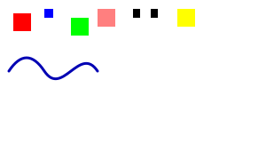

# XML opaque, historique et SVG — 2026-10-10

**US-032, US-072 et US-081 sont développées, revues et validées : 17 US sur 158.** Le lot a été développé en parallèle avec GPT-6 Luna, raisonnement moyen, puis examiné par trois agents neufs du même modèle.

- [US-032](us-032-opaque-xml.md) conserve un sous-arbre XML inconnu, ses préfixes et les namespaces utilisés uniquement dans des valeurs QName. Capture bornée depuis le dernier start du lecteur, puis réémission autonome ; fidélité sémantique, sans promesse sur les octets d’origine.
- [US-072](us-072-undo-history.md) fournit un historique générique de transactions atomiques, des snapshots de sélection, le regroupement des frappes et un budget logique déclaré par l’appelant. Les codecs durables et le modèle de sélection concret restent indépendants.
- [US-081](us-081-svg-backend.md) produit un SVG par page, avec contours de glyphes dédupliqués, images incorporées, chemins, transparence, clips et transformations. Le fournisseur de ressources est synchrone et en mémoire ; les métadonnées de liens restent inertes.

## Validation et preuves

**160 tests du workspace et 76 tests release passent** : 24 dans atelier-model, 19 dans atelier-render et 33 dans atelier-xml. Les quatorze contrôles globaux réussissent.

La [validation globale](../_bmad-output/implementation-artifacts/editing-validation.json) vérifie Windows, WASM, musl, tests natifs et release, Clippy, rustfmt, SPDX, garde du lock et métadonnées. Les tests musl sont compilés localement sur Windows ; leur exécution dépend du job Linux du [workflow GitHub](https://github.com/simkamil/mon-bureau/actions/workflows/ci.yml).

L’[oracle indépendant](../_bmad-output/implementation-artifacts/editing-oracle.json) compare 24 captures XML UTF-8/UTF-16 à ElementTree, vérifie 258 contrôles de scopes et 10 000 étapes d’historique contre un modèle de référence. Il contrôle aussi la syntaxe XML du SVG, sa répétabilité, la déduplication des glyphes et les octets PNG incorporés.

Le [SVG témoin](../_bmad-output/implementation-artifacts/editing-svg-example.svg) a été rasterisé avec Sharp/libvips/librsvg. Huit [contrôles de pixels](../_bmad-output/implementation-artifacts/editing-svg-visual.json) vérifient clips croisés, ordre des transformations, transparence, placements des glyphes et image. L’image a également été inspectée visuellement :

La validation dans un navigateur n’a pas été effectuée : les fichiers nécessaires au navigateur intégré sont indisponibles et le contrôle automatique d’autorisation a rejeté le lancement de Chrome headless (« blocked by policy »). Le moteur SVG local apporte une preuve de rendu indépendante ; l’impression WebView2 relève d’une story ultérieure.

Les limites des images portent sur le type MIME, la signature et les tailles ; le backend ne valide pas intégralement les formats encodés. Le budget d’historique est une borne logique conservatrice fournie par l’appelant, et non une mesure universelle de l’allocateur Rust.

Les [revues triées](../_bmad-output/implementation-artifacts/editing-review.md) ont conduit au nettoyage terminal des erreurs de capture XML, à la fermeture du groupe de frappe après undo et au renforcement des vérifications de géométrie SVG, de clips vides et d’ordre undo/redo. Aucun constat différé.
